# utd-rs

**Sistem informasi Bank Darah Rumah Sakit (BDRS) dan Unit Transfusi Darah milik RS (UTD-RS) untuk rumah sakit di Indonesia.**

utd-rs menelusuri setiap kantong darah dari penerimaan di bank darah, uji pratransfusi, pengeluaran, sampai verifikasi di samping tempat tidur dan pemantauan reaksi transfusi. Aplikasi ini dipasang **on-premise** di jaringan RS dengan Docker. Backend ditulis dalam Rust (axum + PostgreSQL) dan antarmuka web dalam SvelteKit.

> *English summary:* utd-rs is an open-source hospital blood bank and transfusion management system built for Indonesian regulations (Permenkes 91/2015, CPOB/BPOM, Permenkes 24/2022 on electronic medical records). It covers blood bag receipt from blood centres, ISBT 128 label scanning, FEFO stock, storage temperature monitoring, pre-transfusion testing with mandatory second-person verification, emergency release, two-nurse bedside checks that block mismatches, transfusion reaction tracing, an optional donor/blood-centre module, monthly reports, and a hash-chained append-only audit trail. The UI and code identifiers are in Indonesian.

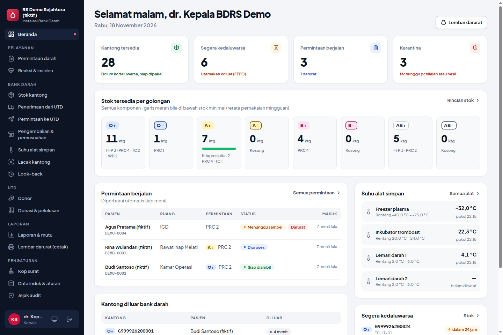

---

## Daftar isi

- [Tangkapan layar](#tangkapan-layar)
- [Fitur](#fitur)
- [Tech stack](#tech-stack)
- [Keselamatan pasien dan integritas data](#keselamatan-pasien-dan-integritas-data)
- [Dasar regulasi](#dasar-regulasi)
- [Mencoba dengan data demo](#mencoba-dengan-data-demo)
- [Pemasangan di rumah sakit](#pemasangan-di-rumah-sakit)
- [Konfigurasi](#konfigurasi)
- [Integrasi](#integrasi)
- [Arsitektur](#arsitektur)
- [Pengembangan](#pengembangan)
- [Dokumentasi](#dokumentasi)
- [Berkontribusi](#berkontribusi)
- [Lisensi dan batasan](#lisensi-dan-batasan)

---

## Tangkapan layar

Semua data di tangkapan layar ini fiktif, dibuat dengan `utdrs seed-demo`.

| | |
|---|---|
| 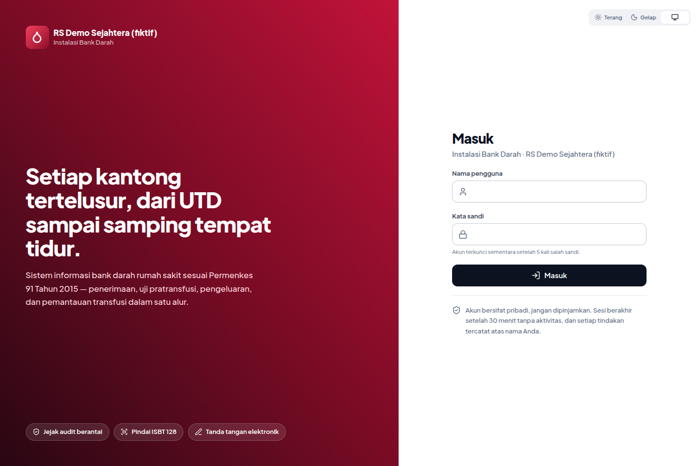 **Masuk.** Judul dan logo mengikuti kop surat RS. | 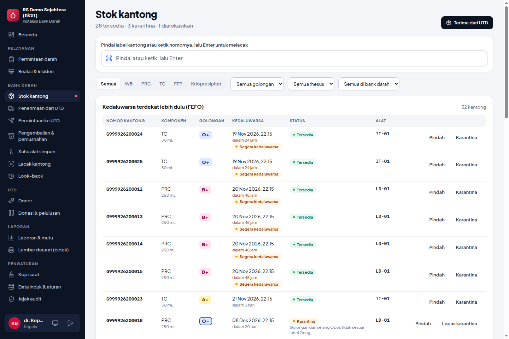 **Stok kantong.** Bidang pindai label ISBT 128, filter komponen, urutan kedaluwarsa terdekat lebih dulu (FEFO). |
| 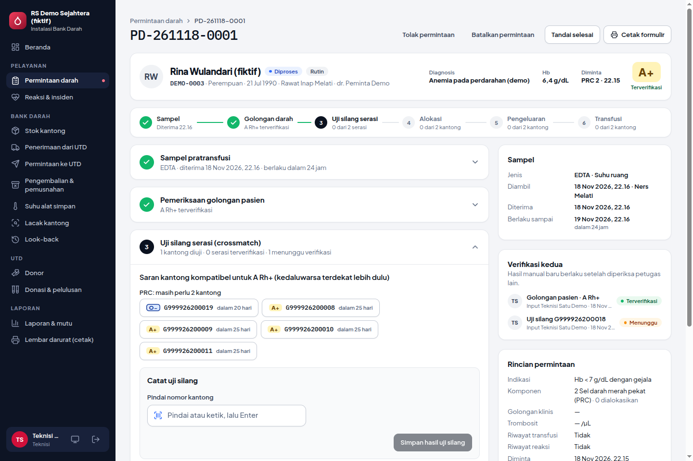 **Detail permintaan darah.** Kartu pasien, enam tahap alur, tahap yang selesai dilipat, verifikasi kedua di kolom kanan. | 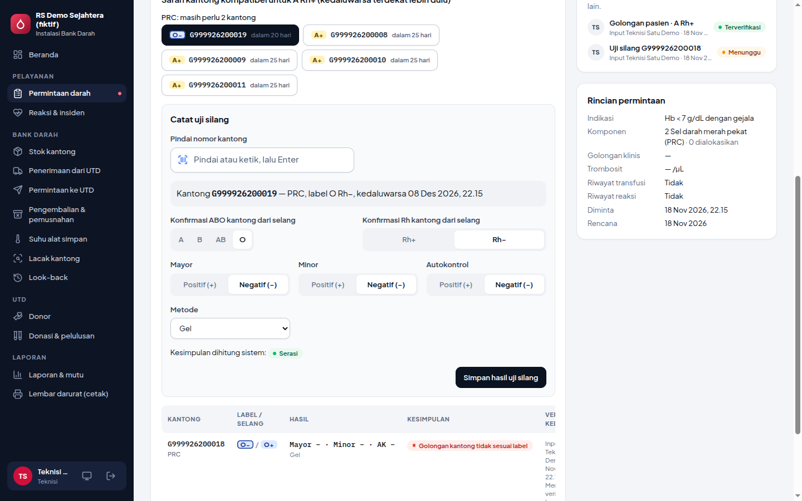 **Uji silang serasi.** Saran kantong kompatibel, konfirmasi golongan dari selang, hasil mayor/minor/autokontrol, kesimpulan dihitung sistem. |
| 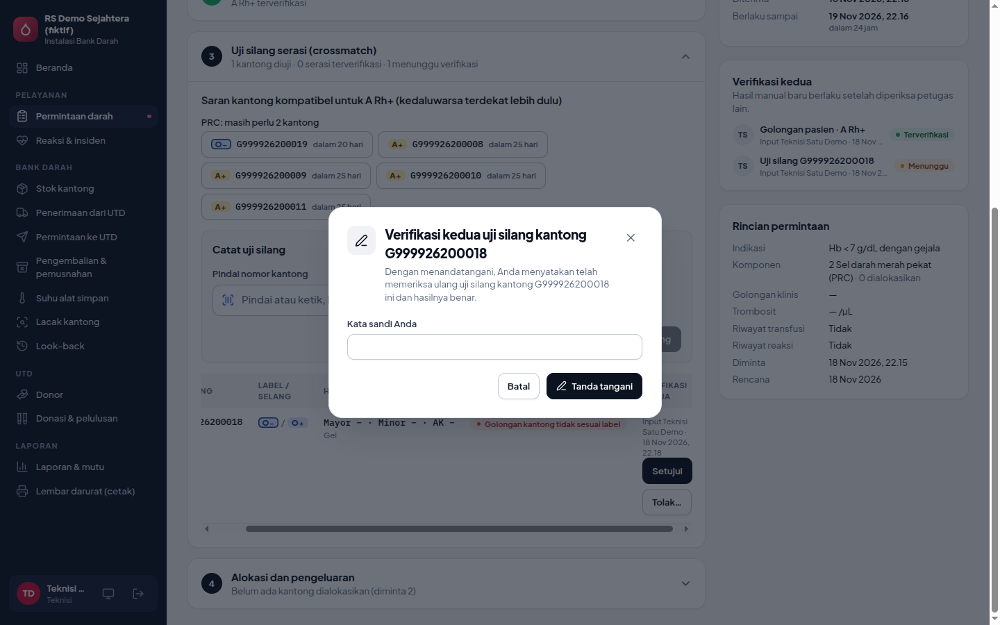 **Tanda tangan elektronik.** Verifikasi kedua oleh petugas lain dengan konfirmasi sandi. | 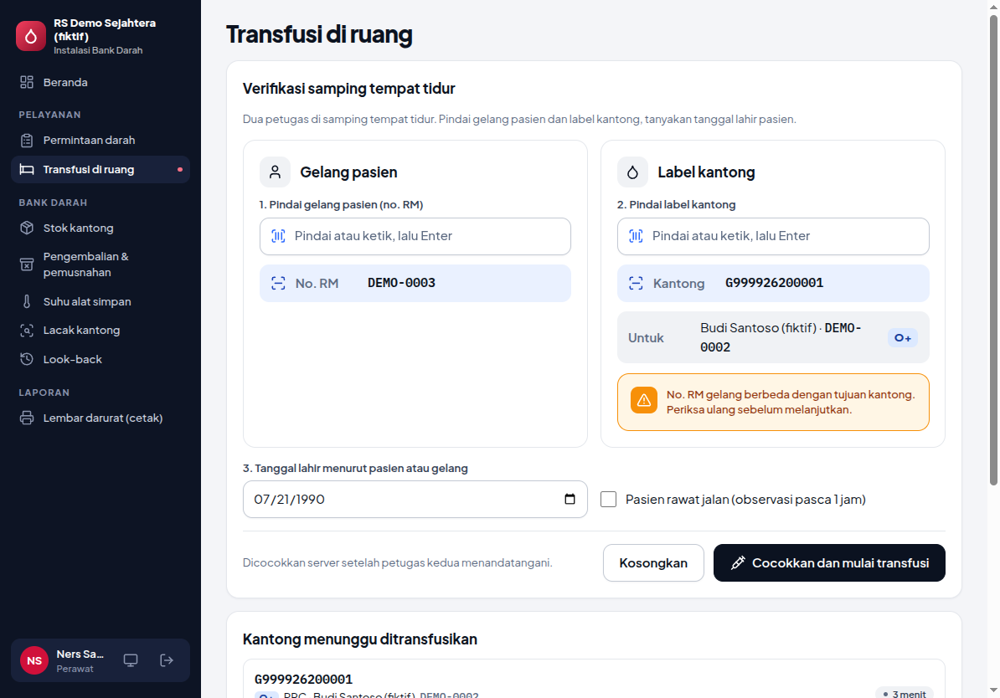 **Samping tempat tidur (tablet).** Pindai gelang pasien dan label kantong; peringatan dini bila tujuan kantong berbeda. |
| 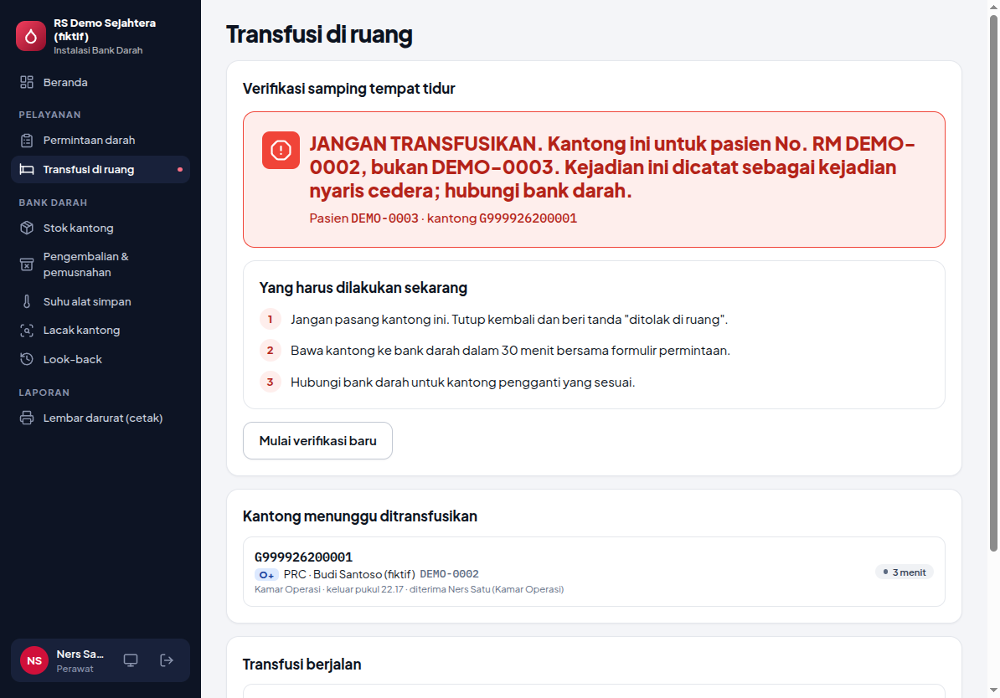 **Transfusi diblokir.** Ketidakcocokan menghentikan transfusi dan otomatis dicatat sebagai Kejadian Nyaris Cedera (KNC). | 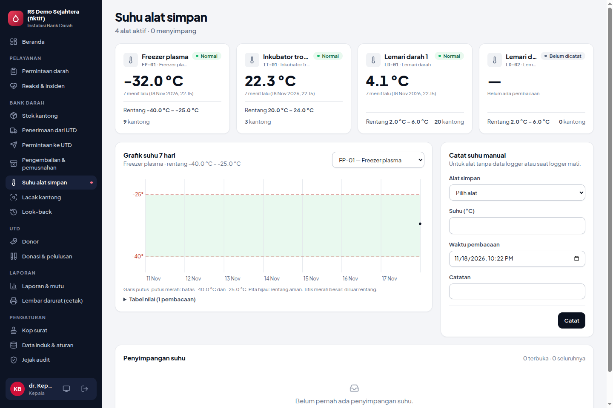 **Suhu alat simpan.** Suhu terakhir per alat, grafik 7 hari, pencatatan manual atau dari data logger. |
| 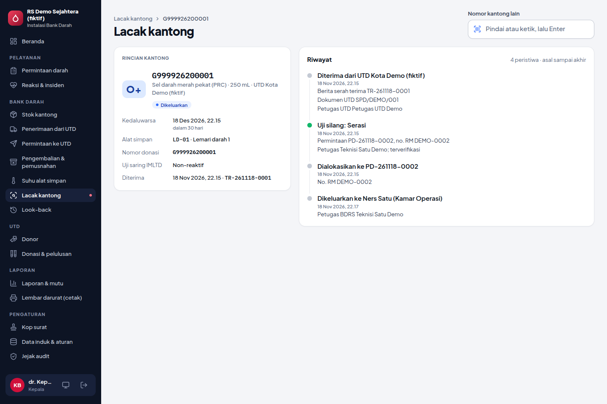 **Lacak kantong.** Identitas kantong dan riwayat lengkap dari UTD sampai pasien. | 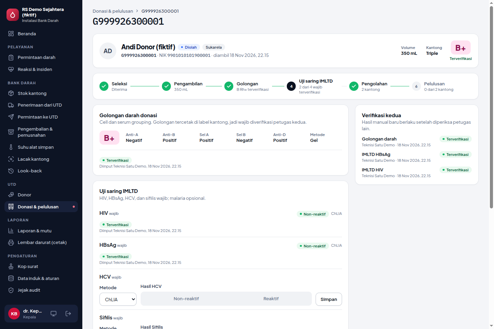 **Donasi dan pelulusan (mode UTD-RS).** Golongan donasi, uji saring IMLTD, pengolahan, pelulusan bertanda tangan. |
| 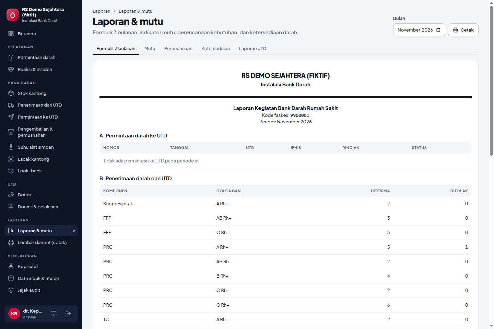 **Laporan.** Formulir 3 bulanan siap cetak dengan kop surat, indikator mutu, perencanaan stok. | 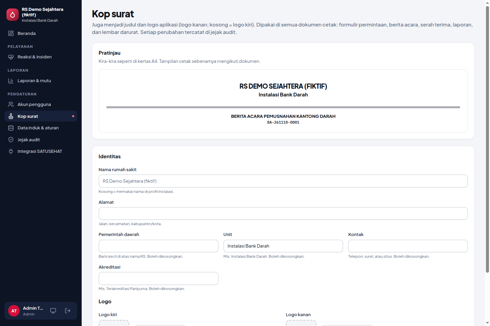 **Kop surat.** Identitas RS dan logo untuk semua dokumen cetak dan judul aplikasi. |
| 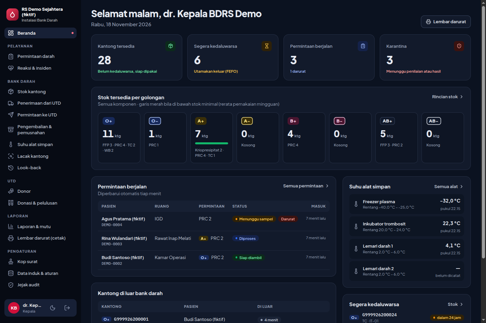 **Mode gelap.** Terang, gelap, atau ikuti sistem; dokumen cetak selalu terang. | |

---

## Fitur

### Bank darah (BDRS)

- **Permintaan ke UTD mitra** (rutin, khusus, darurat) dan **penerimaan kantong** dengan berita serah terima. Kantong dicatat dengan memindai label ISBT 128 (kode produk, golongan, dan kedaluwarsa diurai otomatis) atau label lokal UTD. Kantong yang ditolak saat diterima tetap tercatat beserta alasannya.
- **Stok** per komponen (WB, PRC, TC, FFP, kriopresipitat) dan golongan, diurutkan kedaluwarsa terdekat (FEFO), dengan peringatan "segera kedaluwarsa" yang batasnya diatur per komponen.
- **Pencairan** FFP/kriopresipitat dengan kedaluwarsa yang dipersingkat otomatis, pemindahan antaralat, karantina, dan pelepasan karantina bertanda tangan.
- **Suhu alat simpan**: pencatatan manual atau otomatis dari data logger. Suhu di luar rentang membuka **penyimpangan** dan mengarantina semua kantong di alat itu sampai dinilai satu per satu oleh penanggung jawab.
- **Pengembalian ke UTD dan pemusnahan** dengan berita acara siap cetak.
- **Lacak kantong** dan **look-back** bila donor belakangan reaktif.
- **Lembar darurat** siap cetak (stok, golongan pasien terverifikasi, prosedur manual) untuk saat sistem tidak bisa diakses.

### Pelayanan pasien

- **Permintaan darah** sesuai formulir Permenkes 91/2015 §5.6, termasuk jalur darurat. SIMRS juga dapat mengirim permintaan lewat API.
- **Sampel pratransfusi** dengan batas usia sesuai jenis dan penyimpanan (EDTA 24 jam di suhu ruang atau 3 hari dingin, serum 7 hari dingin) dan alasan penolakan sampel yang baku.
- **Golongan ABO/Rh pasien** (cell dan serum grouping) dengan tafsir otomatis, deteksi diskrepansi terhadap riwayat, dan **verifikasi kedua**.
- **Uji silang serasi** per kantong: saran kantong kompatibel, konfirmasi golongan dari selang kantong, mayor/minor/autokontrol sesuai aturan per komponen, dan CCC untuk metode tabung. Kesimpulan dihitung sistem; kantong yang golongan selangnya beda dari label otomatis dikarantina.
- **Alokasi dan pengeluaran** ke petugas ruang, dengan pengingat 30 menit. Kantong yang tidak jadi dipakai bisa diterima kembali.
- **Verifikasi samping tempat tidur** oleh dua perawat (pindai gelang, pindai label, tanggal lahir). Ketidakcocokan memblokir transfusi dan otomatis dicatat sebagai KNC.
- **Observasi transfusi** (pra, 15 menit, berkala, pasca) dengan koreksi beralasan dalam 2×24 jam, **pelaporan reaksi transfusi**, dan **penelusuran** oleh BDRS (periksa ulang golongan, uji silang ulang, kesimpulan).
- **Riwayat pasien**: semua permintaan, transfusi, reaksi, dan pemeriksaan golongan per no. RM.

### Mode UTD-RS (opsional)

Untuk RS yang juga mengambil darah donor (CPOB BPOM). Mode ini diaktifkan di **Data induk → Profil instalasi**.

- **Donor**: identitas, riwayat donasi, dan **cekal** (sementara/permanen).
- **Seleksi donor** dengan ambang yang dapat diatur (umur, berat badan, Hb, tekanan darah, nadi, suhu, interval antardonasi).
- **Donasi, golongan donasi, uji saring IMLTD** (HIV, HBsAg, HCV, sifilis wajib; malaria opsional) dengan verifikasi kedua, **pengolahan komponen**, dan **pelulusan** bertanda tangan elektronik.
- Hasil reaktif otomatis mencekal donor dan membuka **look-back** atas donasi sebelumnya.
- Kantong yang diluluskan atau dimusnahkan masuk antrean **SATUSEHAT** (modul UPD).

### Laporan

- **Formulir 3** bulanan (Permenkes 91/2015) siap cetak dengan kop surat.
- **Indikator mutu**: rasio C:T per komponen, waktu tunggu permintaan darurat, permintaan tidak terpenuhi, kantong kedaluwarsa dan dimusnahkan, reaksi, dan insiden.
- **Perencanaan stok** dari rerata pemakaian mingguan, **ketersediaan darah**, dan **laporan UTD**.

### Pengaturan

- **Akun dan peran**: admin, dokter, perawat, teknisi, kepala, auditor, dan akun layanan `simrs`/`logger` dengan token API.
- **Kop surat** untuk semua dokumen cetak; nama RS dan logonya juga menjadi judul dan logo aplikasi.
- **Data induk dan aturan**: UTD mitra, alat simpan dan rentang suhunya, aturan per komponen (uji silang, batas peringatan kedaluwarsa, pencairan), aturan seleksi donor.
- **Jejak audit** dengan filter dan pemeriksaan keutuhan rantai.
- **Tema** terang, gelap, atau ikuti sistem.

---

## Tech stack

<p>
  &nbsp;
  &nbsp;
  &nbsp;
  &nbsp;
  &nbsp;
  &nbsp;
  &nbsp;
  &nbsp;
  &nbsp;
</p>

Semua dependensi terbuka (open source) dan dibundel ke dalam image, jadi aplikasi berjalan penuh di jaringan RS tanpa akses internet. Satu-satunya layanan luar adalah SATUSEHAT, dan itu opsional.

### Backend

| Komponen | Versi | Kegunaan |
|---|---|---|
|  [Rust](https://www.rust-lang.org/) | edition 2024, minimal 1.94 | Bahasa backend, dikompilasi menjadi satu binary `utdrs` |
|  [axum](https://github.com/tokio-rs/axum) | 0.8 | Router HTTP dan API JSON |
|  [tokio](https://tokio.rs/) | 1.x | Runtime async |
|  [tower-http](https://github.com/tower-rs/tower-http) | 0.7 | Penyajian berkas antarmuka, log permintaan |
|  [sqlx](https://github.com/launchbadge/sqlx) | 0.9 | Akses PostgreSQL dan migrasi; query runtime ([ADR 0007](docs/adr/0007-build-dan-query.md)) |
|  [argon2](https://crates.io/crates/argon2) | 0.6 | Hash kata sandi |
|  [sha2](https://crates.io/crates/sha2) | 0.11 | Rantai hash jejak audit, sidik tanda tangan, token API |
|  [reqwest](https://crates.io/crates/reqwest) (rustls) | 0.13 | Klien HTTPS ke SATUSEHAT |
|  [serde](https://serde.rs/) / serde_json | 1.x | Serialisasi JSON |
|  [time](https://crates.io/crates/time), [uuid](https://crates.io/crates/uuid) (v7) | 0.3 / 1.x | Waktu dan ID |
|  [tracing](https://crates.io/crates/tracing) | 0.1 | Log terstruktur (JSON) |
|  [thiserror](https://crates.io/crates/thiserror), [anyhow](https://crates.io/crates/anyhow) | 2.x / 1.x | Galat berbahasa Indonesia untuk pengguna |

### Frontend

| Komponen | Versi | Kegunaan |
|---|---|---|
|  [SvelteKit](https://svelte.dev/docs/kit) + adapter-static | 3.x | Aplikasi satu halaman (SPA) statis yang dilayani langsung oleh binary Rust |
|  [Svelte](https://svelte.dev/) | 5 (runes) | Komponen antarmuka |
|  [TypeScript](https://www.typescriptlang.org/) | 6.x | Bahasa frontend |
|  [Vite](https://vite.dev/) | 8.x | Build dan server pengembangan |
|  [Tailwind CSS](https://tailwindcss.com/) | 4.x | Gaya lewat token warna (`web/src/app.css`) |
|  [Lucide](https://lucide.dev/) (`@lucide/svelte`) | 1.x | Ikon |
|  [Plus Jakarta Sans](https://github.com/tokotype/PlusJakartaSans), [IBM Plex Mono](https://github.com/IBM/plex) (Fontsource) | 5.x | Huruf teks dan huruf nomor kantong/no. RM, dibundel tanpa CDN |

Bagian frontend tidak memakai pustaka UI, pustaka state, atau pustaka grafik tambahan. Komponennya ada di `web/src/lib/`, dan grafik suhu digambar dengan SVG.

### Database dan infrastruktur

| Komponen | Versi | Kegunaan |
|---|---|---|
|  [PostgreSQL](https://www.postgresql.org/) | 17 | Database; trigger audit berantai hash, batasan data di skema |
|  [Docker](https://www.docker.com/) + Compose v2 | Engine ≥ 24 | Pemasangan on-premise: `db`, `app`, `proxy`, `backup` |
|  [Caddy](https://caddyserver.com/) | 2.10 | Reverse proxy, TLS (sertifikat RS atau sertifikat internal), HSTS |
|  Image dasar | `rust:1-bookworm` → `debian:bookworm-slim`, `node:24-alpine`, `postgres:17-alpine` | Build multi-tahap; aplikasi berjalan sebagai pengguna non-root dengan healthcheck |
|  Backup | `pg_dump` + OpenSSL AES-256 (PBKDF2) + cron | Backup harian terenkripsi, salinan ke lokasi kedua, checksum SHA-256 |

### Integrasi dan standar

| Standar | Dipakai untuk |
|---|---|
|  ISBT 128 | Pengurai label kantong (nomor donasi, kode produk, golongan, kedaluwarsa) di `web/src/lib/isbt.ts` |
|  HL7 FHIR R4 (`BiologicallyDerivedProduct`) | Pengiriman ke SATUSEHAT modul UPD lewat outbox |
|  OAuth2 client credentials | Token akses SATUSEHAT |
|  REST + JSON, token Bearer | API untuk SIMRS dan data logger suhu |

### Pengujian dan kualitas

| Alat | Kegunaan |
|---|---|
|  `#[sqlx::test]` + `tower::ServiceExt` | Uji API ujung ke ujung; setiap uji mendapat database PostgreSQL baru yang sudah dimigrasi |
|  `cargo clippy`, `rustfmt` | Lint dan format backend |
|  `svelte-check` | Pemeriksaan tipe Svelte/TypeScript |
|  `node --test` | Uji unit frontend (pengurai ISBT 128) |
|  [FigCraft](https://getartcraft.com/apps/figcraft) | Desain antarmuka (`design/utd-rs.figcraft`, dibangun oleh `design/layar.py`) |

---

## Keselamatan pasien dan integritas data

- **Verifikasi kedua.** Setiap hasil yang diinput manual (golongan pasien, uji silang, golongan donasi, IMLTD) baru berlaku setelah diperiksa ulang oleh petugas lain. Penginput tidak bisa memverifikasi hasilnya sendiri.
- **Tanda tangan elektronik** ([ADR 0005](docs/adr/0005-tanda-tangan-dan-audit.md)): konfirmasi ulang kata sandi, terikat pada hash isi catatan. Petugas kedua memakai nama pengguna dan sandinya sendiri.
- **Jejak audit append-only berantai hash.** Setiap perubahan data, dan setiap kali data pasien atau donor dibuka, dicatat dalam transaksi yang sama. Fungsi `audit_periksa()` mendeteksi bila ada baris yang diubah diam-diam.
- **Tidak ada penghapusan data** ([ADR 0003](docs/adr/0003-tidak-ada-penghapusan.md)). Pembatalan dan koreksi selalu beralasan dan riwayatnya tetap tersimpan, sesuai kewajiban retensi rekam medis.
- **Aturan klinis di server.** Kompatibilitas ABO/Rh, batas usia sampel, kedaluwarsa, dan karantina diperiksa backend, bukan hanya di layar.
- **Keamanan akses**:
  - sesi di server dengan cookie `HttpOnly`/`SameSite=Strict`;
  - batas diam 30 menit dan sesi maksimal 12 jam;
  - akun terkunci setelah 5 kali salah sandi;
  - wajib ganti sandi saat masuk pertama;
  - sandi di-hash dengan Argon2;
  - hak akses per peran di setiap endpoint;
  - header keamanan dan CSP ketat.
- **Backup terenkripsi** (AES-256) harian dengan salinan di lokasi kedua dan prosedur uji pemulihan.

---

## Dasar regulasi

Pemetaan lengkap ada di [`docs/research/regulasi-utd-rs.md`](docs/research/regulasi-utd-rs.md) (34 requirement fungsional, 22 non-fungsional) dan [`docs/kepatuhan.md`](docs/kepatuhan.md). Rujukan utamanya:

- **Permenkes 91/2015** tentang Standar Pelayanan Transfusi Darah: alur BDRS, formulir permintaan, uji pratransfusi, pemantauan transfusi, Formulir 3.
- **Permenkes 83/2014** tentang UTD, BDRS, dan Jejaring Pelayanan Transfusi Darah.
- **PP 28/2024** (pelaksanaan UU 17/2023 tentang Kesehatan), yang menggantikan PP 7/2011 tentang Pelayanan Darah.
- **Peraturan BPOM 11/2025** tentang CPOB di UTD, termasuk Aneks 2 sistem komputerisasi. Berlaku untuk mode UTD-RS.
- **Permenkes 24/2022** tentang Rekam Medis: rekam medis elektronik, retensi, dan backup.
- **UU 27/2022** tentang Pelindungan Data Pribadi.
- **SATUSEHAT** modul Unit Pelayanan Darah ([ADR 0006](docs/adr/0006-satusehat-hanya-modul-upd.md)).

utd-rs membantu pemenuhan regulasi, tetapi tidak menggantikan kewajiban RS. Dokumen yang tetap harus disiapkan RS (pendaftaran PSE, petugas pelindungan data, validasi sistem komputerisasi, SPO) tercantum di [`docs/kepatuhan.md`](docs/kepatuhan.md).

---

## Mencoba dengan data demo

Kebutuhan: Docker Engine ≥ 24 dengan Docker Compose v2.

```sh
git clone <url-repo> utd-rs && cd utd-rs
cp deploy/env.contoh .env          # untuk mencoba, isi sandi dengan nilai acak apa saja
docker compose up -d --build
docker compose exec app /app/utdrs seed-demo
```

Buka `https://utd.rs.lokal`, atau domain yang diisi di `UTD_DOMAIN`. Tambahkan dulu domain itu ke `/etc/hosts` bila belum ada di DNS. Caddy memakai sertifikat internal, jadi browser akan meminta Anda memercayainya sekali.

Akun demo (sandi semuanya `demo-utd-rs`):

| Nama pengguna | Peran | Untuk mencoba |
|---|---|---|
| `kepala` | Kepala BDRS | Hampir semua layar, persetujuan, laporan |
| `teknisi` | Teknisi | Penerimaan, stok, sampel, golongan, uji silang |
| `teknisi2` | Teknisi | Verifikasi kedua hasil `teknisi` |
| `dokter` | Dokter | Membuat permintaan darah, persetujuan darurat |
| `perawat` | Perawat | Verifikasi samping tempat tidur, observasi, reaksi |
| `perawat2` | Perawat | Petugas kedua di samping tempat tidur |
| `admin` | Admin TI | Akun, kop surat, data induk, integrasi |
| `auditor` | Auditor | Jejak audit (hanya baca) |

Data demo memakai mode UTD-RS, berisi pasien, kantong, permintaan, transfusi, reaksi, dan donor fiktif (NIK berawalan `99`, nomor kantong `G9999…`). **Jangan jalankan `seed-demo` di server produksi.**

---

## Pemasangan di rumah sakit

Panduan lengkap: [`docs/pemasangan.md`](docs/pemasangan.md).

1. Siapkan server Linux 64-bit (2 vCPU, 4 GB RAM, dan 50 GB disk cukup untuk bank darah satu RS), Docker, dan satu nama domain di jaringan RS.
2. `cp deploy/env.contoh .env`, lalu isi sandi database dan frasa sandi backup yang panjang dan acak. Simpan frasa backup di brankas; tanpanya backup tidak bisa dipulihkan.
3. Pasang sertifikat TLS RS di `deploy/sertifikat/`, atau biarkan Caddy membuat sertifikat internal.
4. `docker compose up -d --build`.
5. Buat admin pertama:
   ```sh
   docker compose exec app /app/utdrs buat-admin admin "Nama Admin TI"
   ```
   Sandi sementara diketik saat diminta dan wajib diganti saat masuk pertama.
6. Masuk sebagai admin, lalu isi profil instalasi dan pilih mode BDRS atau UTD-RS, kop surat, UTD mitra, alat simpan, dan akun petugas.
7. Atur backup offsite (`UTD_DIR_OFFSITE`) dan **uji pemulihan** sesuai [`docs/operasional.md`](docs/operasional.md).

Migrasi database berjalan otomatis setiap aplikasi dinyalakan. Untuk memperbarui versi: `git pull && docker compose up -d --build`.

---

## Konfigurasi

Untuk Docker, variabel diisi di `.env` (contoh: [`deploy/env.contoh`](deploy/env.contoh)).

| Variabel | Bawaan | Keterangan |
|---|---|---|
| `UTD_DOMAIN` | `utd.rs.lokal` | Domain yang dilayani Caddy |
| `UTD_PORT_HTTPS` / `UTD_PORT_HTTP` | `443` / `80` | Port di host |
| `UTD_DB_SANDI` | — | Sandi PostgreSQL (wajib) |
| `UTD_BACKUP_PASSPHRASE` | — | Frasa sandi enkripsi backup (wajib) |
| `UTD_BACKUP_RETENSI_HARI` | `30` | Lama backup lokal disimpan |
| `UTD_DIR_BACKUP` / `UTD_DIR_OFFSITE` | `./backup` / `./backup-offsite` | Folder backup lokal dan salinan di lokasi kedua |
| `TZ` | `Asia/Jakarta` | Zona waktu |
| `UTD_SATUSEHAT_ENV` | kosong (mati) | `sandbox` atau `production` |
| `UTD_SATUSEHAT_CLIENT_ID` / `_CLIENT_SECRET` / `_ORG_ID` | — | Kredensial SATUSEHAT, wajib bila `UTD_SATUSEHAT_ENV` diisi |

Variabel yang dibaca langsung oleh binary `utdrs` (sudah diisi di `compose.yaml`): `DATABASE_URL`, `UTD_ALAMAT` (bawaan `0.0.0.0:8080`), `UTD_DIR_WEB` (folder antarmuka), `UTD_COOKIE_SECURE` (`0` hanya untuk pengembangan tanpa HTTPS), dan `UTD_DI_BALIK_PROXY`.

---

## Integrasi

### SIMRS dan data logger suhu

Buat akun berperan `simrs` atau `logger` di **Pengaturan → Akun pengguna**, terbitkan token API, lalu kirim token itu sebagai header `Authorization: Bearer <token>`.

| Endpoint | Peran | Fungsi |
|---|---|---|
| `POST /api/pasien` | `simrs` | Kirim atau perbarui identitas pasien. Data induk pasien tetap milik SIMRS ([ADR 0002](docs/adr/0002-pasien-milik-simrs.md)) |
| `POST /api/permintaan` | `simrs` | Kirim permintaan darah dari order di SIMRS |
| `GET /api/permintaan/{id}` | `simrs` | Baca status, alokasi, dan transfusi permintaan |
| `POST /api/suhu` | `logger` | Kirim pembacaan suhu, mis. `{ "alat_kode": "LD-01", "suhu": 4.2 }` |

Semua permintaan yang mengubah data harus berformat JSON. Pesan galat dikembalikan dalam bentuk `{ "pesan": "...", "isian": [...] }`, berbahasa Indonesia.

### SATUSEHAT

Hanya modul Unit Pelayanan Darah, dan hanya dalam mode UTD-RS. Kantong yang diluluskan atau dimusnahkan dikirim sebagai `BiologicallyDerivedProduct` lewat **outbox** dengan percobaan ulang bertahap, sehingga gangguan jaringan tidak menghambat pelayanan. Status antrean dapat dilihat di **Pengaturan → Integrasi SATUSEHAT**.

> URL extension FHIR untuk `BiologicallyDerivedProduct` belum tercantum di dokumentasi publik Kemenkes. Verifikasi di sandbox SATUSEHAT sebelum memakai `production` (lihat `src/integrasi.rs`).

---

## Arsitektur

```
 Browser (stasiun kerja lab, tablet ruang)
        │ HTTPS
 ┌──────▼──────┐     ┌─────────────────────────────┐     ┌──────────────┐
 │ Caddy (TLS) │────▶│ utdrs (Rust, axum)          │────▶│ PostgreSQL 17│
 └─────────────┘     │  • API JSON di /api         │     └──────┬───────┘
                     │  • antarmuka SvelteKit (SPA) │            │ pg_dump terenkripsi
                     │  • outbox SATUSEHAT          │     ┌──────▼───────┐
 SIMRS / data logger ─▶ token API (Bearer)          │     │ backup harian│──▶ lokasi kedua
                     └─────────────────────────────┘     └──────────────┘
```

- **Satu binary, satu database.** Binary `utdrs` melayani API di `/api` dan antarmuka SPA sekaligus, sehingga tidak ada server Node.js di produksi. Satu modul per domain di `src/`; migrasi bernomor di `migrations/` berjalan otomatis saat aplikasi dinyalakan.
- **Satu aplikasi, dua mode**: BDRS sebagai inti, UTD-RS opsional ([ADR 0001](docs/adr/0001-bdrs-inti-mode-utd-opsional.md)). Aturan yang berbeda antar-RS dapat dikonfigurasi ([ADR 0004](docs/adr/0004-aturan-dapat-dikonfigurasi.md)).
- **Desain antarmuka**: sumbernya di `design/utd-rs.figcraft` (dibuat dengan [FigCraft](https://getartcraft.com/apps/figcraft) lewat skrip `design/layar.py`); aturannya di [`docs/desain.md`](docs/desain.md).

```
src/            backend Rust: satu modul per domain (stok, suhu, permintaan, pratransfusi, transfusi, donor, laporan, …)
src/uji_*.rs    uji ujung ke ujung (#[sqlx::test]) per domain
migrations/     skema PostgreSQL, bernomor urut
web/            antarmuka SvelteKit (src/routes per layar, src/lib komponen bersama)
deploy/         Caddyfile, backup/pemulihan, contoh .env
design/         berkas desain FigCraft dan render PNG
docs/           spesifikasi, ADR, riset regulasi, pemasangan, operasional, validasi
```

---

## Pengembangan

Kebutuhan: Docker (cargo dijalankan di dalam container, jadi tidak perlu toolchain Rust atau compiler C di mesin) dan Node.js 24.

```sh
scripts/dev-db.sh start                 # PostgreSQL dev di localhost:54330
scripts/cargo.sh test                   # semua uji backend (database baru per uji)
scripts/cargo.sh clippy --all-targets   # lint
scripts/dev-server.sh seed-demo         # isi data demo (sekali, database kosong)
scripts/dev-server.sh                   # API di localhost:8080

cd web
npm install
npm run dev                             # antarmuka di localhost:5173, proxy /api ke :8080
npm run check                           # pemeriksaan tipe Svelte/TypeScript
npm test                                # uji unit (pengurai ISBT 128, dll.)
```

Konvensi kode ada di [`CLAUDE.md`](CLAUDE.md). Ringkasnya:

- Nama dan teks memakai bahasa Indonesia, mengikuti istilah di [`GLOSSARY.md`](GLOSSARY.md).
- Setiap handler memeriksa hak peran lebih dulu, dan setiap perubahan dicatat di audit dalam transaksi yang sama.
- Status kantong hanya diubah lewat `stok::ubah_status`.
- Migrasi yang sudah di-commit tidak diubah.
- Antarmuka memakai token warna dan komponen bersama (`KepalaHalaman`, `Keadaan`, `Isian`, `Pilihan`, `Pindai`, `DialogSandi`, `Golongan`, `Chip`, `Kop`).
- Setiap requirement punya uji yang dapat dilacak di [`docs/validasi.md`](docs/validasi.md).

---

## Dokumentasi

| Berkas | Isi |
|---|---|
| [`docs/SPEK.md`](docs/SPEK.md) | Spesifikasi modul M1–M8 dan keputusan atas pertanyaan terbuka |
| [`docs/adr/`](docs/adr/) | Catatan keputusan arsitektur |
| [`docs/research/regulasi-utd-rs.md`](docs/research/regulasi-utd-rs.md) | Riset regulasi dan requirement (FR/NFR) |
| [`GLOSSARY.md`](GLOSSARY.md) | Istilah domain: kantong, uji silang serasi, alokasi, KNC, cekal, pelulusan, … |
| [`docs/pedoman/Pedoman-Penggunaan-utd-rs.pdf`](docs/pedoman/Pedoman-Penggunaan-utd-rs.pdf) | **Pedoman penggunaan dan pelatihan** untuk semua peran (PDF, 41 halaman); sumbernya `pedoman.html`, dibuat ulang dengan `docs/pedoman/buat-pdf.sh` |
| [`docs/pemasangan.md`](docs/pemasangan.md) | Kebutuhan server, pemasangan, admin pertama, TLS, pembaruan versi |
| [`docs/operasional.md`](docs/operasional.md) | Backup dan uji pemulihan, prosedur saat sistem mati, insiden, peninjauan audit |
| [`docs/kepatuhan.md`](docs/kepatuhan.md) | Pemetaan regulasi ke fitur dan dokumen yang harus disiapkan RS |
| [`docs/validasi.md`](docs/validasi.md) | Matriks keterlacakan requirement ke uji, dasar validasi sistem komputerisasi |
| [`docs/desain.md`](docs/desain.md) | Sistem desain antarmuka |

---

## Berkontribusi

Kontribusi sangat diterima, terutama dari praktisi bank darah, UTD, dan TI rumah sakit.

- **Laporkan masalah** lewat *Issues*: langkah untuk mereproduksi, apa yang diharapkan, apa yang terjadi. **Jangan lampirkan data pasien atau donor asli.**
- **Usulan perubahan klinis** sertakan rujukan regulasi atau standar (pasal Permenkes, CPOB, AABB, dan sebagainya). Aturan yang berbeda antar-RS sebaiknya dijadikan pengaturan, bukan diubah untuk semua.
- **Pull request**: sertakan uji (`src/uji_*.rs` untuk backend), jalankan `scripts/cargo.sh test`, `scripts/cargo.sh clippy --all-targets`, `npm run check`, dan `npm test`, lalu rujuk ID requirement (FR-xx/NFR-xx) di commit bila relevan.
- **Celah keamanan** jangan dilaporkan di issue publik. Gunakan fitur *private vulnerability reporting* (Security Advisories) di repositori ini.

---

## Lisensi dan batasan

utd-rs dirilis di bawah lisensi **GNU Affero General Public License v3.0 atau yang lebih baru** ([`LICENSE`](LICENSE)). Anda bebas memakai, mempelajari, mengubah, dan membagikannya. Bila versi yang diubah dijalankan untuk pengguna lewat jaringan, kode sumbernya wajib disediakan bagi pengguna tersebut.

**Batasan penting:**

- **Bukan alat kesehatan bersertifikat.** utd-rs belum melalui sertifikasi atau izin edar apa pun. Setiap RS bertanggung jawab memvalidasi sistem sebelum dipakai untuk pelayanan, mengikuti [`docs/validasi.md`](docs/validasi.md) dan ketentuan sistem komputerisasi CPOB, serta menyusun SPO-nya sendiri.
- **Keputusan klinis tetap di tangan petugas.** Peringatan dan perhitungan sistem membantu, bukan menggantikan, pemeriksaan dan pertimbangan petugas yang berwenang.
- **Perangkat lunak ini disediakan "apa adanya"**, tanpa jaminan apa pun (lihat Pasal 15–16 lisensi).
